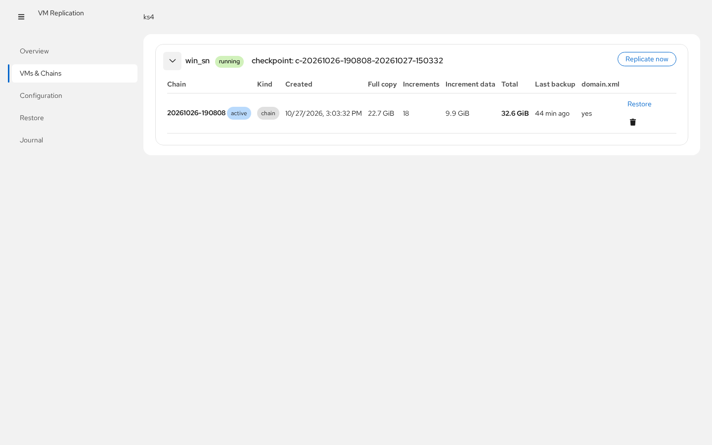
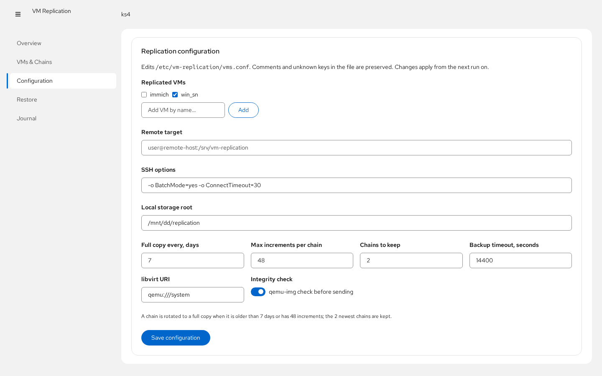

# cockpit-vm-replication

Приложение для [Cockpit](https://cockpit-project.org), управляющее
инкрементальной репликацией виртуальных машин libvirt/KVM — техникой
«push-бэкап с чекпоинтами» на основе `virsh backup-begin` с зеркалированием
на удалённый хост по rsync.


## Что оно делает

Основную работу выполняют два root-скрипта, которые входят в проект:

- **`vm-replicate`** — для *работающей* ВМ делает копию через
  `virsh backup-begin` (push-режим) с *чекпоинтом*: первая копия цепочки
  полная, дальнейшие ежечасные — **инкременты только из изменившихся
  блоков**, ВМ не останавливается. Для *выключенной* ВМ — холодная
  rsync-копия. Каталог цепочки (`full-*.qcow2` + `inc-*.qcow2` +
  `domain.xml` + `vm-restore`) зеркалится на удалённый хост через
  `rsync --delete` по SSH, старые цепочки и лишние чекпоинты удаляются
  автоматически.
- **`vm-restore`** — собирает цепочку (full + инкременты) обратно в один
  образ qcow2 (rebase + convert), не трогая файлы цепочки.

Часовой systemd-таймер запускает задание. Интерфейс Cockpit даёт:

| Вкладка | Возможности |
|---|---|
| **Overview** | состояние таймера и следующий запуск, занятость хранилища, здоровье по каждой ВМ (состояние, активная цепочка, число инкрементов, объём, время последней копии, результат), запуск «сейчас» для всех ВМ или одной |
| **VMs & Chains** | все сохранённые цепочки с размерами и временем; удаление цепочки; переход к восстановлению |
| **Configuration** | правка `/etc/vm-replication/vms.conf` (список ВМ, удалённый целевой хост, опции ssh, каталог хранения, политика ротации) — комментарии в файле сохраняются; кнопка **Check access** проверяет введённый remote target ещё до сохранения: ssh-авторизацию по ключу, наличие rsync на удалённой стороне и доступность пути; если ключ хоста ещё не принят, кнопка **Accept host key** покажет отпечатки и добавит сервер в `known_hosts` одним кликом; в интерфейсе можно **сгенерировать выделенный SSH-ключ**, перегенерировать, удалить и скопировать публичную часть — пока ключ существует, он используется для зеркалирования автоматически (`-i … -o IdentitiesOnly=yes`) |
| **Restore** | собрать цепочку в один qcow2 на этом хосте с проверкой места, плюс готовые команды для восстановления на удалённой стороне |
| **Journal** | живой просмотр `journalctl -t vm-replication` с фильтром и автообновлением |

## Скриншоты

| | |
|---|---|
|  |  |
|  |  |

## Требования

- Debian 12+/Ubuntu 22.04+ или RHEL-семейство, **Cockpit ≥ 265** (пакет `cockpit`)
- `libvirt` + ВМ KVM с дисками в qcow2
- `python3`, `rsync`, `openssh-client` (на обычном сервере уже есть)
- Пользователь Cockpit, которому разрешён **один фиксированный запуск через
  sudo** (см. ниже)

## Установка

```bash
git clone https://github.com/yourname/cockpit-vm-replication.git
cd cockpit-vm-replication
npm install          # инструменты сборки (нужен nodejs ≥ 18)
sudo make install
```

`make install` делает следующее:

1. интерфейс → `/usr/share/cockpit/vm-replication/`
2. привилегированный хелпер → `/usr/libexec/cockpit-vm-replication/vm-replication-helper`
3. `vm-replicate` / `vm-restore` → `/usr/local/sbin/`
4. конфиг → `/etc/vm-replication/vms.conf` (существующий не перезаписывается)
5. systemd-юнит + часовой таймер `vm-replication.timer` (включается)
6. drop-in в sudoers, разрешающий членам групп `sudo`/`wheel` запускать
   **только** хелпер без пароля:
   ```
   %sudo  ALL=(root) NOPASSWD: /usr/libexec/cockpit-vm-replication/vm-replication-helper
   %wheel ALL=(root) NOPASSWD: /usr/libexec/cockpit-vm-replication/vm-replication-helper
   ```
7. правило AppArmor для libvirt, если каталог хранения лежит вне
   `/var/lib/libvirt/images`

Затем откройте `https://сервер:9090` → пункт **VM Replication** в меню.
Если пункт не появился сразу — перезагрузите страницу (и дайте службе
Cockpit минуту, если она работала во время установки).

### Первичная настройка

1. На вкладке **Configuration** отметьте ВМ для репликации, при желании
   задайте `REMOTE_TARGET` (`user@backup-host:/srv/vm-replication`) и
   подстройте политику ротации. Нестандартный ssh-порт вписывается в
   **SSH options** (`-p 2222`). Кнопка **Check access** проверяет цель
   с текущими значениями полей — сохранять заранее не нужно.
2. Для зеркала на удалённый хост настройте беспарольный SSH от root. Либо
   сгенерируйте выделенный ключ прямо на вкладке Configuration
   (**Generate key** → **Copy** → дописать в `~/.ssh/authorized_keys`
   целевого пользователя на удалённом хосте — подхватится автоматически),
   либо используйте ключ root по умолчанию:
   `sudo ssh-copy-id -p 2222 user@backup-host`. Если **Check access**
   сообщает о `Host key verification failed`, нажмите **Accept host key** —
   интерфейс покажет отпечатки и доверит сервер в один клик, без терминала.
3. Нажмите **Run now** и следите за журналом на вкладке Journal.

## Как устроена репликация

```
ВМ (running) ──virsh backup-begin (push)──▶ /mnt/.../vm/chain/
   │                                          full-20261026-190808/*.qcow2
   └── чекпоинт c-<chain>-<ts>                inc-<ts>-vda.qcow2  (ежечасно)
                                              domain.xml, vm-restore
                    rsync --delete по ssh ──▶ user@remote:/srv/vm-replication/vm/chain/
```

- Цепочка ротируется в новую полную копию спустя `FULL_EVERY_DAYS` дней или
  после `MAX_INCS` инкрементов; хранятся `KEEP_CHAINS` последних цепочек.
- По умолчанию копии crash-consistent; поставьте в гостя `qemu-guest-agent`,
  чтобы получать копии с фризом файловой системы.
- Восстановление на удалённом хосте: в каждой цепочке лежат копии
  `vm-restore` и `domain.xml`:
  ```bash
  ./vm-restore <каталог-цепочки> /var/lib/libvirt/images/vm.qcow2
  virsh define <каталог-цепочки>/domain.xml   # поправить путь к диску при необходимости
  virsh start vm
  ```

## Модель безопасности

Браузер не получает root-оболочку. Интерфейс общается с одним Python-хелпером
с фиксированным набором подкоманд (`status`, `run`, `config-set`,
`restore-start`, …). Правило sudoers разрешает только хелпер; хелпер
валидирует все аргументы, ограничивает операции с цепочками каталогом
`STORAGE_ROOT`, отвергает выход за его пределы и никогда не запускает shell
с пользовательским вводом. Правка конфига — белым списком ключей с
сохранением комментариев. Альтернатива sudo: интерфейс сам откатывается на
`pkexec` (polkit), если беспарольный sudo для хелпера не настроен.

## Удаление

```bash
sudo make uninstall   # UI + хелпер + sudoers; скрипты, конфиг и данные остаются
sudo make purge       # плюс скрипты, юниты и /etc/vm-replication
```

Сами копии в `STORAGE_ROOT` при удалении не трогаются.

## Разработка

```bash
npm install
npm run watch           # esbuild в режиме слежения
sudo make install-app   # выложить dist/ в /usr/share/cockpit/vm-replication
```

Стек: React 18 + PatternFly 6, сборка esbuild, `cockpit.js` из base1.
Привилегированная часть — только стандартная библиотека Python 3.

## Лицензия

MIT — см. [LICENSE](LICENSE).
