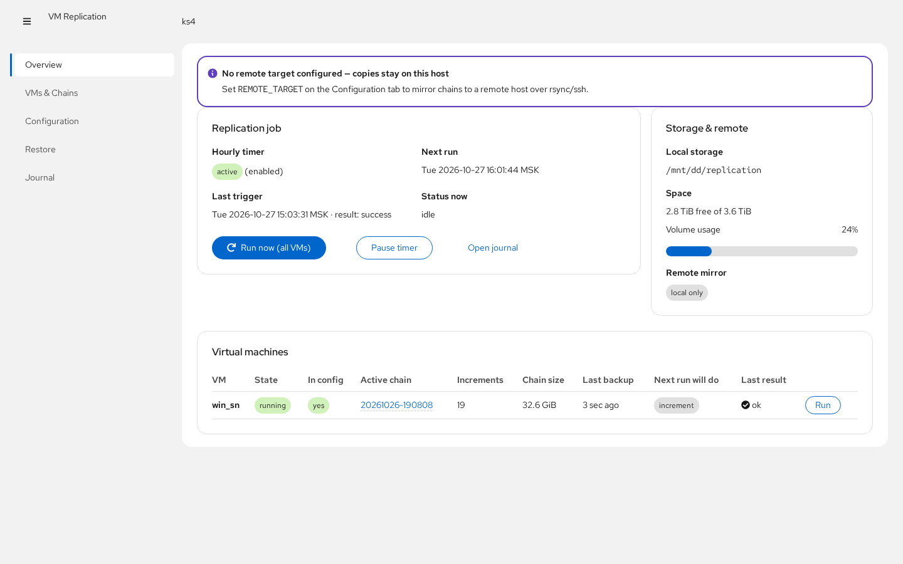
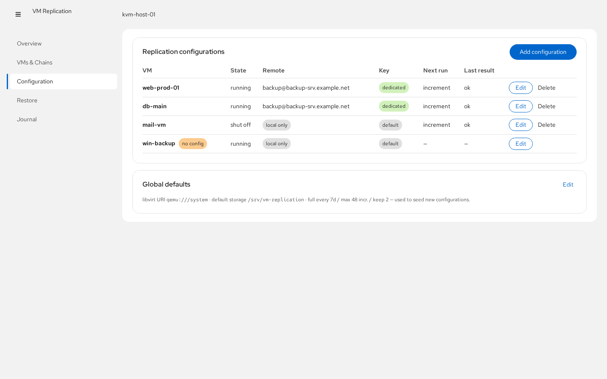
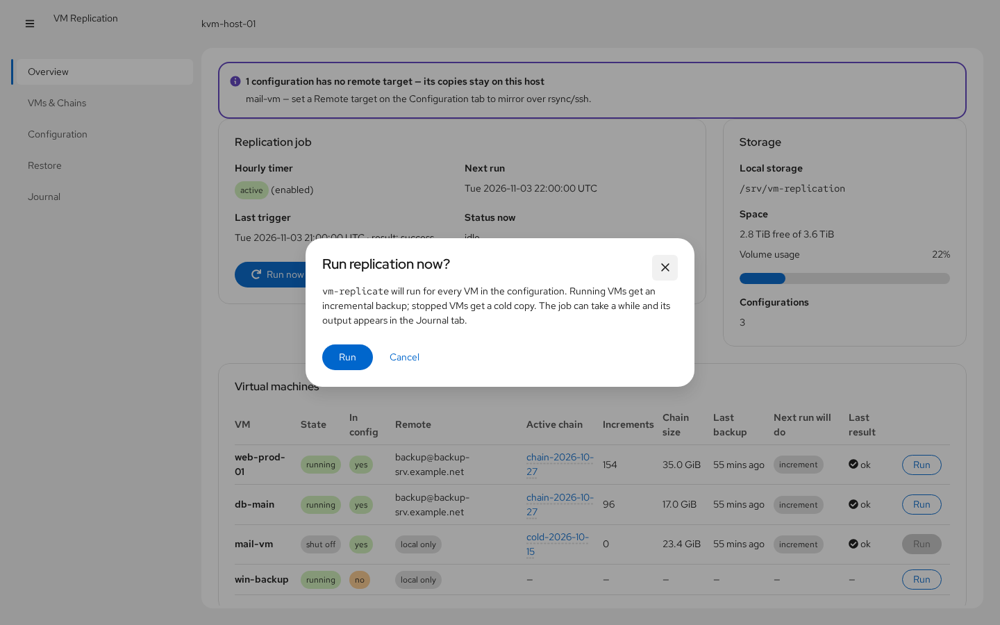
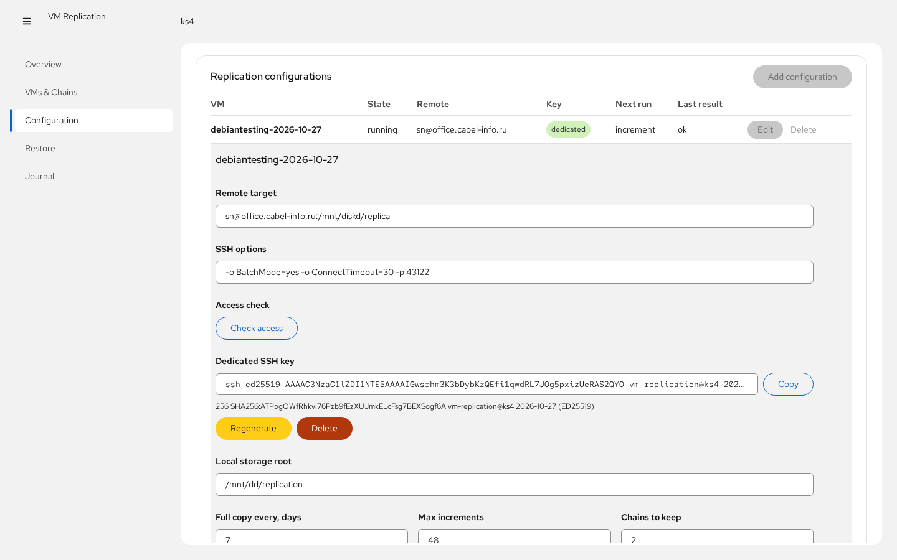
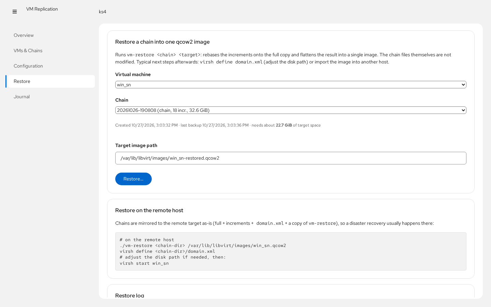

# cockpit-vm-replication

Приложение для [Cockpit](https://cockpit-project.org), управляющее
инкрементальной репликацией виртуальных машин libvirt/KVM — техникой
«push-бэкап с чекпоинтами» на основе `virsh backup-begin` с зеркалированием
на удалённый хост по rsync.



## Что оно делает

Основную работу выполняют два root-скрипта, которые входят в проект:

- **`vm-replicate`** — для *работающей* ВМ делает копию через
  `virsh backup-begin` (push-режим) с *чекпоинтом*: первая копия цепочки
  полная, дальнейшие ежечасные — **инкременты только из изменившихся
  блоков**, ВМ не останавливается. Для *выключенной* ВМ — холодная
  rsync-копия. Каталог цепочки (`full-*.qcow2` + `inc-*.qcow2` +
  `domain.xml` + `vm-restore`) зеркалится на удалённый хост через
  `rsync --delete` по SSH, старые цепочки и лишние чекпоинты удаляются
  автоматически.
- **`vm-restore`** — собирает цепочку (full + инкременты) обратно в один
  образ qcow2 (rebase + convert), не трогая файлы цепочки.

Часовой systemd-таймер запускает задание. Каждая **конфигурация репликации
независима и привязана к своей ВМ**: свой remote target, ssh-опции, каталог
хранения, политика ротации и свой SSH-ключ. Интерфейс Cockpit даёт:

| Вкладка | Возможности |
|---|---|
| **Overview** | состояние таймера и следующий запуск, занятость хранилища, здоровье по каждой ВМ (состояние, активная цепочка, число инкрементов, объём, время последней копии, результат), запуск «сейчас» для всех ВМ или одной |
| **VMs & Chains** | все сохранённые цепочки с размерами и временем; удаление цепочки; переход к восстановлению |
| **Configuration** | таблица конфигураций по ВМ с **Добавить / Изменить / Удалить**; каждая строка разворачивается в форму для своей ВМ — **переключатель активности** (`ACTIVE` — выключенная ВМ пропускается и по расписанию, и вручную), **режим запуска** (по почасовому расписанию или только вручную кнопкой), удалённая цель, ssh-опции, каталог хранения, политика ротации и **выделенный SSH-ключ** (сгенерировать / скопировать / перегенерировать / удалить), который автоматически используется для этой конфигурации; кнопка **Проверить доступ** испытывает введённую цель до сохранения (ssh-авторизация, наличие rsync, доступность пути), а **Принять ключ узла** доверяет неизвестному серверу в один клик. Отдельная карточка **Глобальные значения** правит `LIBVIRT_URI` и значения-шаблон для новых конфигураций |
| **Restore** | собрать цепочку в один qcow2 на этом хосте с проверкой места, плюс готовые команды для восстановления на удалённой стороне |
| **Journal** | живой просмотр `journalctl -t vm-replication` с фильтром и автообновлением |

## Скриншоты

| | |
|---|---|
|  |  |
|  |  |

## Требования

- Debian 12+/Ubuntu 22.04+ или RHEL-семейство, **Cockpit ≥ 265** (пакет `cockpit`)
- `libvirt` + ВМ KVM с дисками в qcow2
- `python3`, `rsync`, `openssh-client` (на обычном сервере уже есть)
- Пользователь Cockpit, которому разрешён **один фиксированный запуск через
  sudo** (см. ниже)

## Установка

```bash
git clone https://github.com/alex653/cockpit-vm-replication.git
cd cockpit-vm-replication
npm install          # инструменты сборки (нужен nodejs ≥ 18)
sudo make install
```

`make install` делает следующее:

1. интерфейс → `/usr/share/cockpit/vm-replication/`
2. привилегированный хелпер → `/usr/libexec/cockpit-vm-replication/vm-replication-helper`
3. `vm-replicate` / `vm-restore` → `/usr/local/sbin/`
4. конфиг → `/etc/vm-replication/`: `defaults.conf` (глобальные + шаблон) и
   пустые `vms.d/` (по файлу `<vm>.conf` на конфигурацию) и `keys/`; старый
   единый `vms.conf` версии до 2.0 мигрируется в `vms.d/` автоматически
   (оригинал сохраняется как `vms.conf.pre-vmsd.bak`)
5. systemd-юнит + часовой таймер `vm-replication.timer` (включается)
6. drop-in в sudoers, разрешающий членам групп `sudo`/`wheel` запускать
   **только** хелпер без пароля:
   ```
   %sudo  ALL=(root) NOPASSWD: /usr/libexec/cockpit-vm-replication/vm-replication-helper
   %wheel ALL=(root) NOPASSWD: /usr/libexec/cockpit-vm-replication/vm-replication-helper
   ```
7. правило AppArmor для libvirt для каждого каталога хранения вне
   `/var/lib/libvirt/images`

Затем откройте `https://сервер:9090` → пункт **VM Replication** в меню.
Если пункт не появился сразу — перезагрузите страницу (и дайте службе
Cockpit минуту, если она работала во время установки).

### Первичная настройка

1. На вкладке **Configuration** нажмите **Add configuration**, выберите ВМ,
   задайте её remote target (`user@backup-host:/srv/vm-replication`),
   ssh-опции (нестандартный порт — сюда как `-p 2222`), каталог хранения и
   политику ротации. Кнопка **Check access** проверяет цель с текущими
   значениями полей — сохранять заранее не нужно. Повторите для каждой ВМ;
   конфигурации независимы.
2. Для зеркала на удалённый хост настройте беспарольный SSH. Либо
   **Generate key** прямо в форме конфигурации (**Copy** → дописать в
   `~/.ssh/authorized_keys` целевого пользователя на удалённом хосте — этот
   отдельный ключ подхватится автоматически), либо используйте ключ root по
   умолчанию: `sudo ssh-copy-id -p 2222 user@backup-host`. Если **Check
   access** сообщает о `Host key verification failed`, нажмите **Accept host
   key** — интерфейс покажет отпечатки и доверит сервер в один клик.
3. Нажмите **Запустить сейчас** (все конфигурации) или **Запустить** в строке
   и следите за журналом. У кнопок **Запустить** / **Реплицировать сейчас**
   есть меню ⋮, принудительно выбирающее тип копии — **полная** или
   **инкремент** (без него тип определяется политикой `FULL_EVERY_DAYS` /
   `MAX_INCS`). ВМ в режиме «только вручную» почасовой таймер пропускает —
   она реплицируется только по кнопке; переключатель **Активность** в обеих
   таблицах выключает репликацию ВМ без удаления её конфигурации.

## Как устроена репликация

```
ВМ (running) ──virsh backup-begin (push)──▶ <STORAGE_ROOT>/<vm>/<chain>/
   │                                          full-<chain>/*.qcow2
   └── чекпоинт c-<chain>-<ts>                inc-<ts>-vda.qcow2  (ежечасно)
                                              domain.xml, vm-restore
   rsync --delete по ssh, ключ конфигурации (<keys>/<vm>) ──▶ user@remote:<path>/<vm>/<chain>/
```

- Файлы конфигурации: `defaults.conf` (глобальный) + по одному
  `vms.d/<vm>.conf` на ВМ + `keys/<vm>` (ключ конфигурации), всё в
  `/etc/vm-replication/`.
- Цепочка ротируется в новую полную копию спустя `FULL_EVERY_DAYS` дней или
  после `MAX_INCS` инкрементов; хранятся `KEEP_CHAINS` последних цепочек.
- По умолчанию копии crash-consistent; поставьте в гостя `qemu-guest-agent`,
  чтобы получать копии с фризом файловой системы.
- Восстановление на удалённом хосте: в каждой цепочке лежат копии
  `vm-restore` и `domain.xml`:
  ```bash
  ./vm-restore <каталог-цепочки> /var/lib/libvirt/images/vm.qcow2
  virsh define <каталог-цепочки>/domain.xml   # поправить путь к диску при необходимости
  virsh start vm
  ```

## Модель безопасности

Браузер не получает root-оболочку. Интерфейс общается с одним Python-хелпером
с фиксированным набором подкоманд (`status`, `entry-save`, `key-generate`,
`remote-check`, `run`, `restore-start`, …). Правило sudoers разрешает только
хелпер; хелпер валидирует все аргументы, ограничивает операции с цепочками
каталогом `STORAGE_ROOT` конкретной конфигурации, отвергает выход за его
пределы и никогда не запускает shell с пользовательским вводом. Файлы
конфигурации пишутся из белого списка ключей. Альтернатива sudo: интерфейс сам
откатывается на `pkexec` (polkit), если беспарольный sudo для хелпера не
настроен.

## Удаление

```bash
sudo make uninstall   # UI + хелпер + sudoers; скрипты, конфиг и данные остаются
sudo make purge       # плюс скрипты, юниты и /etc/vm-replication
```

Сами копии в `STORAGE_ROOT` при удалении не трогаются.

## Разработка

```bash
npm install
npm run watch           # esbuild в режиме слежения
sudo make install-app   # выложить dist/ в /usr/share/cockpit/vm-replication
```

Стек: React 18 + PatternFly 6, сборка esbuild, `cockpit.js` из base1.
Привилегированная часть — только стандартная библиотека Python 3.

## Локализация

Язык интерфейса выбирается автоматически по языку сессии Cockpit — тому же,
что пользователь задаёт в настройках Cockpit (или на экране входа).
Отдельного переключателя в приложении нет: поменяйте язык в Cockpit и
обновите страницу — приложение переключится вместе с ним.

Языки в поставке: **английский** (исходные строки), **русский, немецкий,
французский, испанский, итальянский, португальский, польский, украинский,
китайский (упрощённый), японский**.

Механизм: строки интерфейса в коде обёрнуты в `t()` / `tc()` / `tn()` из
`src/i18n.js` — тонкие обёртки над gettext из Cockpit. Переводы лежат в
`po/<язык>.po` и при сборке компилируются в `dist/po.<язык>.js`;
`index.html` подключает `po.js`, который cockpit-ws отдаёт на языке
сессии, подставляя из каталога пакета `po.<язык>.js`. Если подходящего
файла нет, показываются английские строки.

Эталонный перевод — рукописный `po/ru.po`. Остальные языки генерируются
скриптом `tools/gen-po.mjs` из словарей `tools/po-data/<язык>.json`
(записи `msgid → перевод`, для контекстных строк ключ `"ctx\x04msgid"`,
для множественных форм — массивы). После правки JSON выполните
`node tools/gen-po.mjs` и пересоберите проект.

Чтобы добавить язык `<xx>`:

1. Создайте `tools/po-data/<xx>.json` по образцу соседних словарей,
   переведите значения и добавьте язык (с формулой `Plural-Forms`) в
   таблицу `LANGS` в `tools/gen-po.mjs`.
2. `node tools/gen-po.mjs && npm run build` — появится `dist/po.<xx>.js`,
   cockpit-ws подхватит его автоматически.

`node tools/check-po.mjs` (также запускается `make check` и CI) проверяет,
что `.po`-файлы и строки в `src/` не расходятся.

## Лицензия

MIT — см. [LICENSE](LICENSE).
